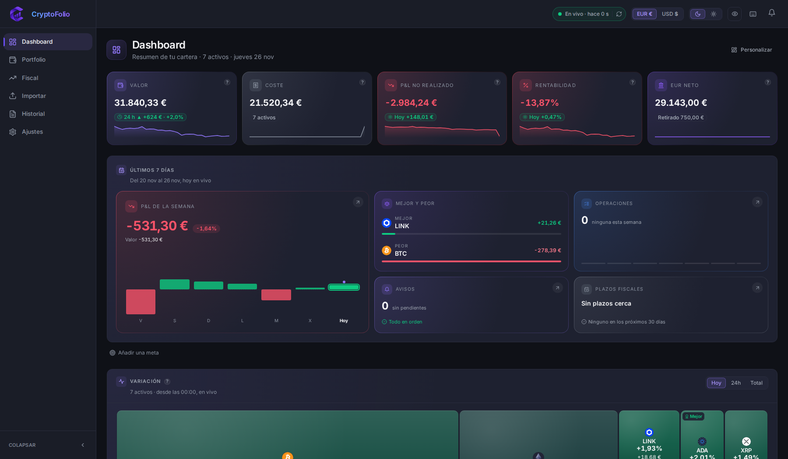
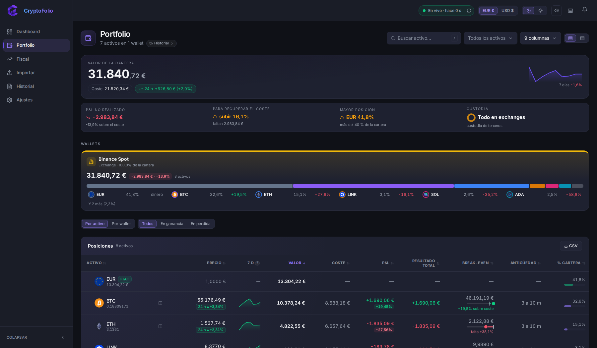
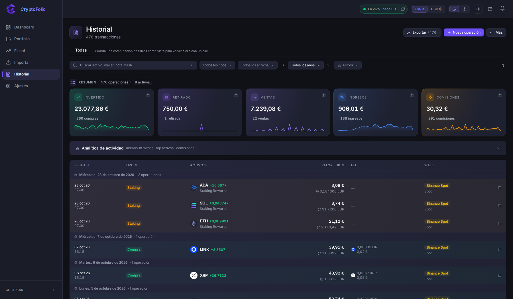
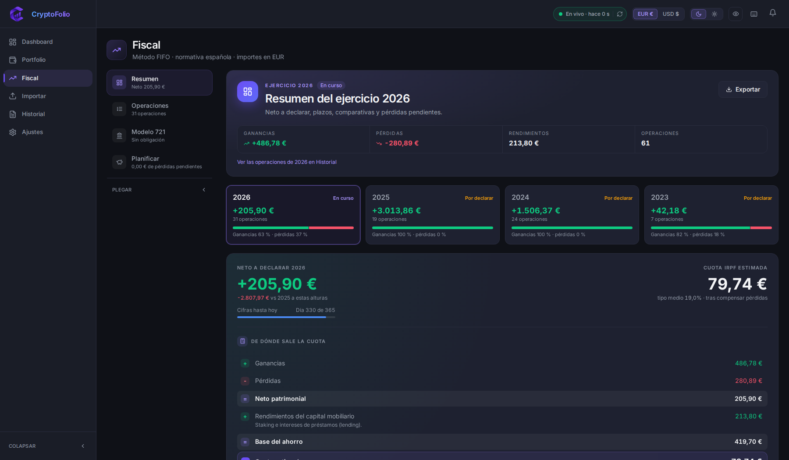
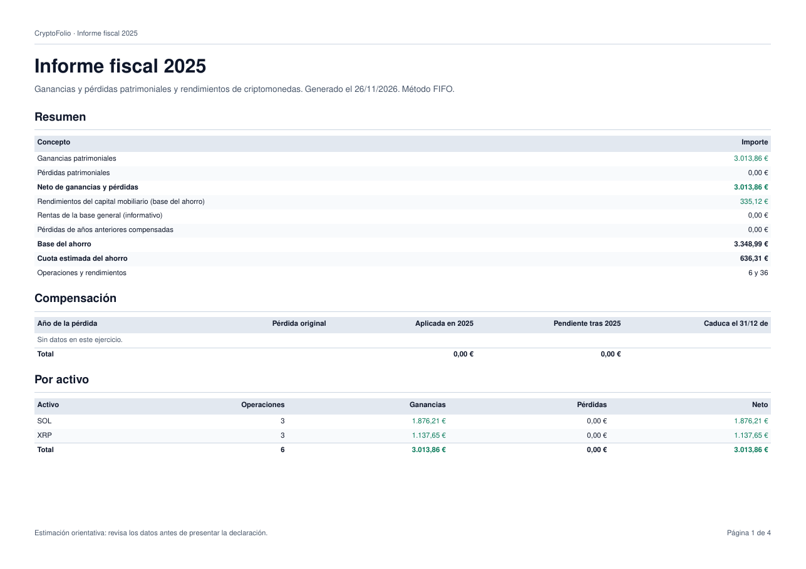

<!-- Cabecera centrada con logo: el título va dentro del bloque HTML. -->
<!-- markdownlint-disable-next-line MD041 -->
<div align="center">


# CryptoFolio

<!-- markdownlint-disable-next-line MD036 -->
**Cartera de criptomonedas y fiscalidad española, en tu propio equipo**

*Tus datos en tu máquina. Sin cuentas, sin suscripciones y sin nube.*

<br/>

[](LICENSE)
[](https://github.com/SrMeirins/CryptoFolio/releases/latest)
[](https://github.com/SrMeirins/CryptoFolio/actions/workflows/ci.yml)
[](https://docs.docker.com/get-docker/)
[](https://react.dev)
[](https://www.typescriptlang.org)
[](https://sede.agenciatributaria.gob.es)

</div>

---

## Qué es CryptoFolio

CryptoFolio es una aplicación **gratuita y de código abierto** para seguir tu cartera de criptomonedas y preparar la declaración de la renta en España.

Se instala en tu ordenador, como aplicación de escritorio para Windows, macOS y Linux o con Docker. No hay que crear ninguna cuenta y tu historial no sale de tu equipo.

> **Por qué en local:** los servicios de fiscalidad cripto en línea cuestan entre 50 y 200 € al año y guardan todo tu historial financiero. Con CryptoFolio, todo se queda en tu máquina.

---

## Compatibilidad

Antes de instalarla, comprueba que cubre tu caso:

| Función | Estado |
| --- | --- |
| **Exchanges para importar** | Binance y Bitvavo (CSV) |
| **Wallets frías** | Alta manual (Ledger, Tangem, Trezor...) |
| **Comprobación de saldo on-chain** | XRP Ledger, Hedera, Stellar, Bitcoin, Solana, Ethereum, Cardano y Polkadot Asset Hub |
| **Método fiscal** | FIFO global por activo |
| **País** | España (IRPF) |
| **Otros exchanges, países o métodos** | No disponibles por ahora |

Si usas Binance o Bitvavo y tributas en España, esta aplicación es para ti.

---

## Índice

- [Funciones](#funciones)
- [Capturas](#capturas)
- [Descarga la aplicación de escritorio](#descarga-la-aplicación-de-escritorio)
- [Instalación con Docker](#instalación-con-docker)
- [Configuración](#configuración)
- [Cómo usar la aplicación](#cómo-usar-la-aplicación)
- [Privacidad y copias de seguridad](#privacidad-y-copias-de-seguridad)
- [Preguntas frecuentes](#preguntas-frecuentes)
- [Stack tecnológico](#stack-tecnológico)
- [Contribuir](#contribuir)
- [Licencia](#licencia)

---

## Funciones

### Dashboard

- Resumen de la cartera en vivo: valor, coste, P&L no realizado, rentabilidad y euros netos aportados, con su evolución.
- **Últimos 7 días:** P&L de la semana, mejor y peor activo, operaciones, avisos y plazos fiscales próximos.
- **Metas** de valor de la cartera, de cantidad de un activo o de dinero aportado, con su progreso.
- Mapa de **variación** por activo (hoy, 24 h o total).
- **Evolución** de la cartera con zoom y marcas de depósitos y retiradas, **rendimiento** por periodos y **P&L diario** en calendario.
- Distribución, resumen fiscal del año, actividad reciente e ingresos pasivos (staking y similares).
- **Personalizable:** ordena, contrae u oculta cada panel.

### Portfolio

- Precios en **tiempo real** por el WebSocket de Binance, con fuentes de respaldo.
- Posiciones por activo o por wallet: precio, valor, coste, P&L, resultado total, precio de equilibrio, antigüedad y peso en la cartera, con columnas configurables y exportación a CSV.
- Custodia: qué parte está en exchanges y qué parte en wallets propias.
- **Detalle de cada activo:** gráfico de precio con tus compras y ventas, lotes por mes, reparto entre wallets, simulación «si vendo» y **alertas de precio**.
- Detección de posiciones residuales (polvo).

### Fiscal (España)

- Cálculo **FIFO** según la normativa española (LIRPF), con ganancias y pérdidas patrimoniales por activo y año.
- Rendimientos del capital mobiliario (staking e intereses) y la clasificación de airdrops, minería y cashback.
- **Cuota IRPF estimada** con la escala del ahorro de cada ejercicio y compensación de pérdidas de años anteriores.
- **Modelo 721:** cálculo de la obligación de declarar criptoactivos en el extranjero.
- **Planificador:** simula ventas antes de hacerlas y aprovecha las pérdidas pendientes.
- Seguimiento de la **declaración** de cada ejercicio y **calendario fiscal** exportable a tu calendario (.ics).
- **Exportación** del ejercicio en CSV, CSV para RentaWeb, Excel y **PDF** listo para el gestor.

### Importación

- CSV de **Binance** (en español o en inglés) y de **Bitvavo**, con más de 60 tipos de operación de Binance: compras, ventas, conversiones, staking, Launchpool, ETH 2.0, airdrops, cashback, bots de Strategy, transferencias internas y margen, entre otros.
- Vista previa antes de confirmar, sin duplicados al volver a importar el mismo fichero.
- Revisión de depósitos y retiradas externos: coste de adquisición y wallet de destino.
- Ajuste de zona horaria del fichero y comprobación de cobertura del historial.
- El motor FIFO se **recalcula solo** tras cada importación.

Referencia completa: [operaciones de Binance](docs/operaciones-soportadas.md) y [operaciones de Bitvavo](docs/operaciones-soportadas-bitvavo.md).

### Historial

- Búsqueda y filtros por fecha, activo, tipo, wallet e importe.
- **Vistas guardadas** en pestañas, con una vista predeterminada.
- Resumen de lo invertido, retirado, vendido, cobrado y pagado en comisiones, y analítica de actividad.
- Detalle de cada operación, edición y alta manual.
- Exportación a **CSV**.

### Ajustes

- Wallets y activos, con la comprobación on-chain del saldo.
- **Conexiones:** claves de API de Etherscan, Blockfrost, Subscan y CoinGecko, comprobadas y cifradas.
- Tramos del IRPF, umbral del Modelo 721 y preferencias de exportación.
- Alertas de cartera y de precio, y notificaciones.
- **Copias de seguridad** automáticas y cifradas, descarga con contraseña y restauración.
- Tema claro u oscuro, moneda (EUR o USD), zona horaria y diseño del Dashboard.

---

## Capturas

Todas las capturas usan la [cartera de demostración](#cartera-de-demostración): datos sintéticos con precios de mercado reales. Se muestran en tema claro u oscuro según el de tu navegador.

### Dashboard

<picture>
  <source media="(prefers-color-scheme: light)" srcset="docs/screenshots/dashboard-claro.png">
  
</picture>

### Portfolio

<picture>
  <source media="(prefers-color-scheme: light)" srcset="docs/screenshots/portfolio-claro.png">
  
</picture>

### Historial

<picture>
  <source media="(prefers-color-scheme: light)" srcset="docs/screenshots/historial-claro.png">
  
</picture>

### Fiscal

<picture>
  <source media="(prefers-color-scheme: light)" srcset="docs/screenshots/fiscal-claro.png">
  
</picture>

### Informe PDF



---

## Descarga la aplicación de escritorio

La versión de escritorio lo instala todo: no necesita Docker ni configuración. Descárgala de la [última release](https://github.com/SrMeirins/CryptoFolio/releases/latest).

| Sistema | Fichero | Notas |
| --- | --- | --- |
| **Windows** (x64) | `CryptoFolio-Setup-<versión>.exe` | Instalador que no pide permisos de administrador |
| **macOS** (Apple Silicon) | `CryptoFolio-<versión>-arm64.dmg` | Sin notarizar: ver la nota de abajo |
| **macOS** (Intel) | `CryptoFolio-<versión>.dmg` | Sin notarizar: ver la nota de abajo |
| **Linux** (x64) | `cryptofolio-desktop_<versión>_amd64.deb` | Debian, Ubuntu y derivadas |

En Linux se instala con `sudo apt install ./cryptofolio-desktop_<versión>_amd64.deb`.

### macOS: abrir una aplicación sin notarizar

La aplicación no está notarizada con una cuenta de Apple Developer. La primera vez:

1. Abre el `.dmg` y arrastra `CryptoFolio.app` a Aplicaciones.
2. En el Finder, haz **clic derecho y Abrir** (no doble clic).
3. Acepta el aviso de desarrollador no identificado.

---

## Instalación con Docker

Para tenerla en un servidor de casa o si prefieres Docker. Funciona en Windows, macOS y Linux y se instala en 5 a 10 minutos.

### Paso 1: instala Docker

<details>
<summary><b>Windows</b></summary>

1. Descarga **Docker Desktop** desde [docker.com/products/docker-desktop](https://www.docker.com/products/docker-desktop/).
2. Ejecuta el instalador y reinicia cuando lo pida.
3. Abre Docker Desktop y espera a que arranque.
4. En **PowerShell**, comprueba que funciona:

   ```powershell
   docker --version
   ```

</details>

<details>
<summary><b>macOS</b></summary>

1. Descarga **Docker Desktop** desde [docker.com/products/docker-desktop](https://www.docker.com/products/docker-desktop/).
2. Arrastra Docker.app a Aplicaciones, ábrelo y acepta los permisos.
3. En **Terminal**, comprueba que funciona:

   ```bash
   docker --version
   ```

</details>

<details>
<summary><b>Linux (Ubuntu o Debian)</b></summary>

Instala Docker con el script oficial y añade tu usuario al grupo `docker` (después, cierra la sesión y vuelve a entrar):

```bash
curl -fsSL https://get.docker.com | sh
sudo usermod -aG docker $USER
docker --version
```

</details>

### Paso 2: descarga CryptoFolio

Con Git (recomendado, para actualizar después con un comando):

```bash
git clone https://github.com/SrMeirins/CryptoFolio.git
cd CryptoFolio
```

Sin Git: en esta página, pulsa **Code** y **Download ZIP**, descomprímelo y abre una terminal en esa carpeta.

### Paso 3: crea el fichero `.env`

Copia la plantilla (en Windows, `Copy-Item .env.example .env`):

```bash
cp .env.example .env
```

Abre `.env` con un editor de texto y define los dos valores obligatorios: la contraseña de la base de datos y la clave maestra, que cifra las claves de API y las copias automáticas. Genera la clave maestra con `openssl rand -base64 32` (en Windows, en Git Bash o WSL) y pégala:

```env
# Contraseña de la base de datos (sin espacios ni comillas)
POSTGRES_PASSWORD=cambia-esta-contraseña
# Clave maestra: el resultado de openssl rand -base64 32
WALLET_SYNC_ENCRYPTION_KEY=pega-aquí-la-clave-generada
```

Si falta alguna, el arranque se detiene con un aviso en lugar de usar un valor por defecto. Guarda la clave maestra: si la cambias, tendrás que volver a introducir las claves de API.

### Paso 4: arranca la aplicación

Construye las imágenes de producción y levanta los contenedores (la primera vez tarda unos minutos):

```bash
docker compose up -d
```

### Paso 5: ábrela en el navegador

Entra en <http://localhost:8080>.

### Parar, arrancar y actualizar

Estos comandos paran la aplicación (los datos se conservan), la vuelven a arrancar, muestran su estado y la actualizan a la última versión:

```bash
docker compose down
docker compose up -d
docker compose ps
git pull && docker compose up -d --build
```

---

## Configuración

Las opciones van en el fichero `.env`. La lista completa, comentada, está en [`.env.example`](.env.example).

| Variable | Para qué sirve | Por defecto |
| --- | --- | --- |
| `POSTGRES_PASSWORD` | Contraseña de la base de datos (**obligatoria**) | Sin valor: el arranque falla si falta |
| `WALLET_SYNC_ENCRYPTION_KEY` | Clave maestra (**obligatoria**): cifra las claves de API y las copias automáticas. Genérala con `openssl rand -base64 32` | Sin valor: el arranque falla si falta |
| `FRONTEND_HOST_PORT` | Puerto de la aplicación en tu equipo | `8080` |
| `APP_TIMEZONE` | Zona horaria del día local, el ejercicio fiscal y el P&L (por ejemplo, `Atlantic/Canary`). La de Ajustes tiene prioridad | `Europe/Madrid` |
| `PRICE_REFRESH_INTERVAL_MS` | Cada cuánto se refrescan los precios, en milisegundos | `60000` |
| `PRICE_SOURCES_OFFLINE` | Con `true`, no consulta ninguna fuente de precios y usa solo la caché | Sin definir |
| `RATE_LIMIT_MAX` | Peticiones al backend por ventana de 15 minutos | `5000` |
| `BACKUP_HOST_DIR` | Carpeta de tu equipo para las copias de la base de datos | `~/.local/share/CryptoFolio/backups` |
| `BACKUP_RETENTION_COUNT` | Copias semanales que se conservan | `14` |
| `HOST_UID` / `HOST_GID` | Usuario y grupo dueños de las copias (salida de `id -u` y `id -g`) | `1000` |
| `ETHERSCAN_API_KEY`, `BLOCKFROST_API_KEY`, `SUBSCAN_API_KEY`, `COINGECKO_API_KEY` | Alternativa a Ajustes, Conexiones para las claves de API. La de Ajustes tiene prioridad | Vacías |

La base de datos y el backend no publican ningún puerto en tu equipo: solo se ven entre sí en la red interna de Docker. El único punto de entrada es el frontend, y solo en `127.0.0.1`.

Si cambias `WALLET_SYNC_ENCRYPTION_KEY` después de usarla, las claves de API guardadas dejan de poder descifrarse (Ajustes, Conexiones lo indica) y tendrás que volver a introducirlas; las copias automáticas anteriores solo se abren con la clave antigua. No se pierden operaciones ni datos de la cartera.

### Claves de API

Se ponen en **Ajustes, Conexiones**, que comprueba cada clave con su servicio antes de guardarla cifrada. Todas son gratuitas y opcionales:

- **Etherscan, Blockfrost y Subscan (PubFi):** comprueban el saldo on-chain de tus direcciones de Ethereum, Cardano y Polkadot Asset Hub. Las demás redes no necesitan clave.
- **CoinGecko (Demo o Pro):** precios e históricos de los activos que no cotizan en Binance. Sin clave funciona, pero unas tres veces más despacio la primera vez.

En la aplicación de escritorio, Ajustes es el único sitio para ponerlas; la clave maestra se genera sola.

---

## Cómo usar la aplicación

1. **Exporta tu historial.** En Binance: Cartera, Historial de transacciones, Generar estado de cuenta, todos los registros. En Bitvavo: Cuenta, Historial, Exportar.
2. **Impórtalo** en la pestaña **Importar**: revisa la vista previa y confirma. El FIFO se recalcula solo.
3. **Añade tus wallets frías** (opcional) en **Ajustes, Wallets**. En las redes compatibles, con la dirección pública la aplicación comprueba el saldo on-chain y avisa si no cuadra.
4. **Revisa tu cartera** en **Dashboard** y **Portfolio**.
5. **Prepara la renta** en **Fiscal**: elige el ejercicio, revisa ganancias, pérdidas y rendimientos, y exporta el informe.

---

## Privacidad y copias de seguridad

- **Tus datos no salen de tu equipo.** Las únicas conexiones externas son consultas de solo lectura: precios (Binance y CoinGecko, con CoinPaprika y OKX de respaldo), logos de los activos, banderas y, si activas la comprobación on-chain, el saldo de tus direcciones públicas en el explorador de cada red. Los detalles están en [SECURITY.md](SECURITY.md).
- **Copias automáticas** desde Ajustes, cifradas con AES-256-GCM y una clave del propio equipo. Para llevarlas a otro equipo, descárgalas protegidas con una contraseña.
- Con Docker, además, una copia semanal de la base de datos en `BACKUP_HOST_DIR`.

---

## Preguntas frecuentes

<details>
<summary><b>¿Funciona con Kraken, Coinbase u otros exchanges?</b></summary>

Todavía no: solo importa CSV de Binance y Bitvavo. Cada exchange necesita su propio intérprete. Si quieres que se añada uno, abre una [issue](https://github.com/SrMeirins/CryptoFolio/issues).

</details>

<details>
<summary><b>¿Puedo usarla si no tributo en España?</b></summary>

La parte de cartera sirve en cualquier país. La parte fiscal sigue exclusivamente la normativa española (IRPF y FIFO), así que sus cálculos no valen para otros países.

</details>

<details>
<summary><b>¿Los cálculos fiscales son correctos?</b></summary>

Siguen el método FIFO y la normativa española vigente, y están cubiertos por tests. Aun así, son orientativos y **no sustituyen a un asesor fiscal**: contrástalos antes de presentar la declaración.

</details>

<details>
<summary><b>¿Qué pasa con mis datos si apago el ordenador?</b></summary>

Nada: la base de datos persiste entre reinicios. En Docker vive en un volumen que solo desaparece si lo borras a propósito (por ejemplo, con `docker compose down -v`).

</details>

<details>
<summary><b><code>docker compose up -d</code> da un error. ¿Qué hago?</b></summary>

Los errores más habituales:

- **Puerto en uso:** otro programa ocupa el 8080. Cambia `FRONTEND_HOST_PORT` en el `.env`.
- **«variable is required»:** falta `POSTGRES_PASSWORD` o `WALLET_SYNC_ENCRYPTION_KEY` en el `.env`.
- **Docker no responde:** abre Docker Desktop y espera a que arranque.
- **Permisos en Linux:** añade tu usuario al grupo `docker` y vuelve a iniciar sesión.

Si sigue fallando, abre una [issue](https://github.com/SrMeirins/CryptoFolio/issues) con el mensaje de error completo.

</details>

---

## Stack tecnológico

| Capa | Tecnología |
| --- | --- |
| Frontend | React 18, TypeScript, Vite, Tailwind CSS, Recharts y TanStack Query |
| Backend | Node.js 24, Express y TypeScript |
| Base de datos | PostgreSQL 16 |
| Escritorio | Electron |
| Precios | Binance (WebSocket y REST) y CoinGecko, con CoinPaprika y OKX de respaldo |
| Despliegue | Docker y Docker Compose |

---

## Contribuir

Las contribuciones son bienvenidas, sobre todo:

- **Nuevos exchanges** (Kraken, Coinbase, KuCoin...).
- **Fiscalidad de otros países.**
- **Errores y sugerencias:** abre una [issue](https://github.com/SrMeirins/CryptoFolio/issues). Para cambios grandes, coméntalo antes en una issue.
- **Vulnerabilidades:** nunca en una issue pública; sigue [SECURITY.md](SECURITY.md).

Los textos de la interfaz siguen la [guía de estilo de textos](docs/guia-estilo-textos.md).

El proceso de trabajo (de la issue a la PR y a la release) está en [flujo del backlog](docs/desarrollo/flujo-backlog.md). Cada PR describe su cambio para el CHANGELOG con un [fragmento](changelog.d/README.md).

### Entorno de desarrollo

El `Makefile` gestiona un entorno con recarga en caliente (`make help` lista todos los comandos). Este comando genera `.env.dev` con secretos y puertos libres, levanta los contenedores y muestra las URL:

```bash
make dev
```

Para pasar los tests de backend, frontend y Electron, el lint y la comprobación de tipos:

```bash
make test
make lint
make typecheck
```

### Cartera de demostración

Para probar la aplicación sin tus datos hay un entorno aparte, con su propia base de datos y sus propios puertos, y una cartera **sintética**: de enero de 2023 a octubre de 2026, con compras periódicas, staking y ventas de siete activos a precios de cierre reales de Binance. No usa nada del entorno de desarrollo. Los tres comandos levantan la demo, cargan la cartera y la borran:

```bash
make demo
make demo-datos
make demo-down
```

### Prueba de humo del navegador

El CI abre cada vista con datos sintéticos y falla ante cualquier error o aviso en la consola del navegador (`frontend/e2e/`). Para lanzarla en local, con un backend en marcha sobre una base cargada con `frontend/e2e/seed.sql`:

```bash
cd frontend
npx playwright install chromium
BACKEND_PROXY_HOST=127.0.0.1:3001 npm run test:e2e
```

En desarrollo es normal ver unos segundos el aviso de que no se puede conectar con `ws://.../ws/prices` mientras el backend se reinicia: la aplicación se reconecta sola.

---

## Licencia

CryptoFolio es **gratuito para uso personal** bajo la licencia [AGPL-3.0](LICENSE).

El uso comercial (ofrecerlo como servicio o integrarlo en un producto de pago) requiere una [licencia comercial](COMMERCIAL_LICENSE.md). Contacto: <marincaserojorge@gmail.com>

---

## Aviso legal

Este software es orientativo y no constituye asesoramiento fiscal. Los cálculos siguen el método FIFO y la normativa española vigente. Consulta con un asesor fiscal antes de presentar tu declaración.

<div align="center">

Hecho en España. Si te resulta útil, dale una estrella al repositorio.

</div>
